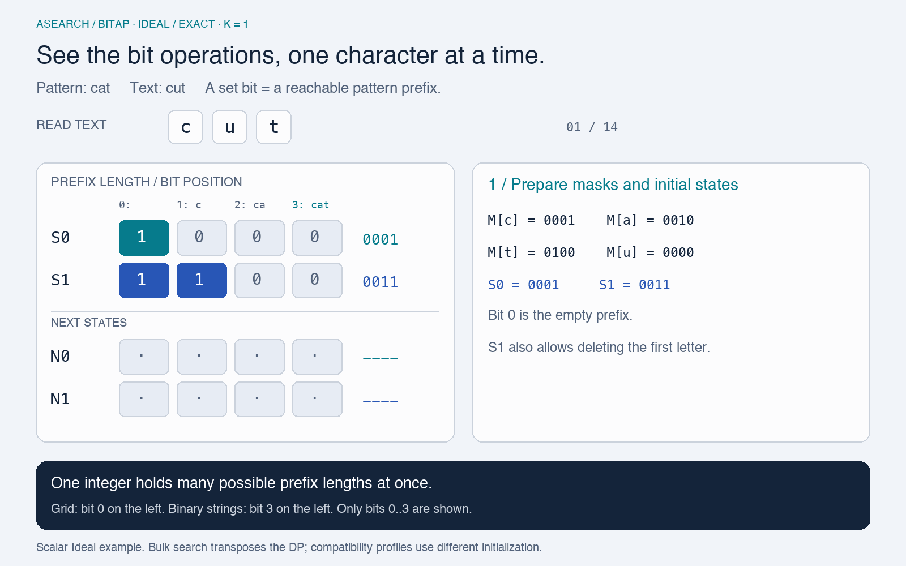

# Bitap: a numerical walkthrough

[日本語](ja/algorithm.md) · [Documentation](README.md)

Bitap represents many possible matching positions as bits and updates them together with AND, OR and SHIFT. Instead of following one path through an automaton, the animation below shows the actual state words and the operations that produce the next words.



[Open the GIF](assets/bitap.gif) · [Static final frame](assets/bitap-poster.png). The 1600 × 1000 animation loops in about 36 seconds. The complete state trace and formulas below also work without animation.

## Scope of the example

The example follows [ScalarWm's Ideal recurrence](../crates/asearch-engine/src/scalar/matching.rs), using `MatchMode::Exact`, pattern `cat`, text `cut` and an edit budget `K = 1`. It uses ASCII, with no normalization step or wildcard loops. “Exact” selects whole-text matching; approximate edits are still allowed by `K`.

This is not a literal trace of every engine. The compatibility matcher uses a different bit orientation and profile initialization. Bulk search transposes the computation, as described below. `IntentIndex` uses bounded DAG × pattern cost computation rather than this scalar loop.

## Encode progress

Bit `i` means that the first `i` pattern symbols can have been consumed. For `cat`, bit 0 is the empty prefix, bit 1 is `c`, bit 2 is `ca`, and bit 3 is the complete pattern. The accepting mask is `1 << 3 = 1000`.

`S[e]` stores positions reachable with **at most** `e` edits after reading the current text prefix. Its bits are a set of possibilities, not a numerical edit count.

| Bit position            | 0     | 1   | 2    | 3     |
| ----------------------- | ----- | --- | ---- | ----- |
| Consumed pattern prefix | empty | `c` | `ca` | `cat` |

The animation's grid places bit 0 on the **left** to show growing prefixes. Conventional binary strings place bit 3 on the **left**. Thus grid `[0, 1, 0, 0]` is binary `0010`. All displayed words are projected onto bits 0 through 3; higher bits cannot shift back into the accepting bit.

## Prepare masks and initial states

`M[x]` has a bit at every pattern position whose next literal is `x`. These are positions **before** consuming the literal:

```text
M['c'] = 0001    M['a'] = 0010
M['t'] = 0100    M['u'] = 0000

S[0] = 0001     # empty pattern prefix, no edits
S[1] = 0011     # also permits deleting the first pattern symbol
```

For a pattern of length `m`, Ideal initialization sets positions `0..min(e, m)` in `S[e]`: up to `e` leading pattern symbols may be deleted before reading any text.

## Process one text symbol

Let `c` be the new text symbol, `S` the previous states, `T` temporary states and `N` the next states. For this Exact example:

```text
N[0] = (S[0] & M[c]) << 1

T[e] = ((S[e] & M[c]) << 1)   # matching literal
     | (S[e - 1] << 1)        # substitution: consume text + pattern
     |  S[e - 1]              # insertion in text: consume text only

N[e] = T[e] | (N[e - 1] << 1) # deletion from pattern: consume no text
```

Compute `T` from the previous states, then compute the deletion closure from lower to higher error levels. In the implementation, the first pass runs downward through the levels to avoid overwriting previous-row inputs, and the closure runs upward. A separate pair of arrays would express the same recurrence.

AND selects literal matches. SHIFT advances their pattern positions. OR retains all allowed alternatives. The error rows are cumulative: a position reachable with fewer edits is also included in every larger-budget row.

## Complete trace: `cat` versus `cut`

| Text consumed | Character mask | `S[0]` after the step | `S[1]` after the step | Meaning                                                                            |
| ------------- | -------------- | --------------------- | --------------------- | ---------------------------------------------------------------------------------- |
| empty         | —              | `0001`                | `0011`                | Initial states, including one allowed leading deletion.                            |
| `c`           | `0001`         | `0010`                | `0111`                | Literal `c` advances the exact path; the one-edit row retains other possibilities. |
| `cu`          | `0000`         | `0000`                | `0110`                | There is no literal `u`; substitution keeps position 2 reachable.                  |
| `cut`         | `0100`         | `0000`                | `1000`                | Literal `t` advances position 2 to the accepting bit.                              |

At `u`, the literal-match contribution is zero. Substitution contributes `S[0] << 1 = 0100`, and insertion contributes `S[0] = 0010`, using the **previous** `S[0] = 0010`. OR yields `0110`. At `t`, the matching contribution becomes `(0110 & 0100) << 1 = 1000`.

After the entire text is consumed, the first error level containing the accepting bit is the minimum cost. Here `S[0] & 1000 = 0`, while `S[1] & 1000 != 0`, so the answer is **level 1**: replace `a` with `u`. Pattern `cat` also accepts `ct` by deleting `a`, or `cart` by inserting `r`, at level 1.

## Modes and compatibility

- **Exact** has no free loops; it matches the whole text within the edit budget.
- **Include** adds free loops at the start and accepting positions, allowing surrounding text.
- **WildcardSpace** treats an ASCII space in the pattern as a free, arbitrary-length loop at that position. It is not a literal-space token or a general regex engine.

Loop-enabled modes add a contribution equivalent to `S[e] & loop_mask` during symbol consumption. Their boundary handling must be read with the relevant implementation. `AsearchTs` and `AsearchTsLib` preserve compatibility behavior and are not interchangeable with the cumulative Ideal initialization shown here. Also, ASIX's `symbol_unit` distinguishes code-point from UTF-16 matching, not every semantic difference between profiles.

For a pattern fitting in one state word, each input symbol needs work proportional to `K + 1` state levels rather than a separate instruction for each pattern position. Multiword states also process the necessary words and carries. Bit parallelism reduces work; it does not make query length, edit budget, corpus size or loading cost disappear.

## How bulk search differs

The [transposed engine](../crates/asearch-engine/src/transposed/matching.rs) packs **corpus text positions** into `u64` words and advances through pattern rows. Symbol equality masks select matching corpus positions. Separator, text and end masks prevent state from leaking between documents, while block processing bounds scratch space.

It combines matching, insertion, deletion and substitution reachability with bit operations, but its bit axes and outer loop differ from this scalar illustration. The index then selects each document's best text, ranks results and applies the live-document view across segments.

Sessions may reuse valid prefix checkpoints or recheck a complete candidate set when narrowing is safe. Those are execution strategies over the same search semantics, not an approximation that searches only the previous top-N results.

## Read the implementation

- [Scalar compiler](../crates/asearch-engine/src/scalar/compiler.rs): literal masks, accepting bit and free loops.
- [Scalar matching](../crates/asearch-engine/src/scalar/matching.rs): initialization, symbol updates and accepting-bit scan.
- [Compatibility matching](../crates/asearch-engine/src/matcher.rs): profile-specific initialization and right-shift representation.
- [Transposed matching](../crates/asearch-engine/src/transposed/matching.rs): corpus-bit rows, blocks and result levels.
- [Scalar regression tests](../crates/asearch-engine/tests/scalar.rs): comparison with an independent dynamic-programming oracle.

## Background reading

The bit-parallel string-searching family is introduced by Baeza-Yates and Gonnet in [A New Approach to Text Searching (1992)](https://doi.org/10.1145/135239.135243). Navarro's [A Guided Tour to Approximate String Matching](https://users.dcc.uchile.cl/~gnavarro/abstracts/acmcs01.1.html) surveys approximate matching techniques. The equations and trace in this document describe this repository's implementation; they do not claim that all algorithms discussed in those papers use identical conventions.
