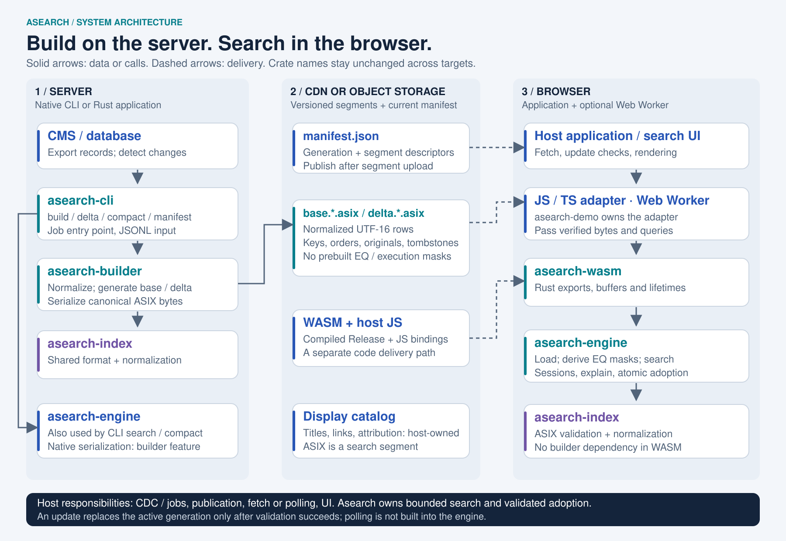

# Architecture: from published content to browser search

[日本語](ja/architecture.md) · [Documentation](README.md)

Asearch separates **server-side segment generation** from **client-side loading and search**. A web service exports its content, creates immutable ASIX segments, publishes them, and asks the browser to adopt a validated generation. The search engine does not own the CMS, network transport or UI.

[Open the scalable SVG](assets/architecture.svg). Arrows show the main calls and delivery paths, rather than every Cargo dependency.

## The five crates

| Crate             | Responsibility in a service                                                                                              | Direct workspace dependencies                                    |
| ----------------- | ------------------------------------------------------------------------------------------------------------------------ | ---------------------------------------------------------------- |
| `asearch-index`   | Shared document types, normalization descriptors, resource limits and ASIX validation.                                   | None                                                             |
| `asearch-builder` | Normalize server inputs and serialize deterministic base/delta bytes, without constructing the search engine.            | `asearch-index`                                                  |
| `asearch-engine`  | Load segments, build derived search structures, search, maintain sessions, explain matches and adopt updates atomically. | `asearch-index`; optional `asearch-builder`                      |
| `asearch-cli`     | Native job entry point for `build`, `delta`, `compact`, `manifest` and `search`.                                         | `asearch-builder`, `asearch-engine`, `asearch-index`             |
| `asearch-wasm`    | Expose Rust handles and bounded transport/lifecycle operations through `wasm-bindgen`.                                   | `asearch-engine` with default features disabled; `asearch-index` |

`asearch-engine` enables its `builder` feature by default for native construction/serialization APIs. The WASM crate disables that feature, so its dependency graph excludes `asearch-builder`. The same `asearch-index` source is compiled for each target; this does not imply a shared process or memory between server and browser.

## Initial publication and load

1. **The host exports records.** Each document has a stable `key`, an `order` and one or more searchable texts. Display URLs, titles and attribution can live in a separate application catalog keyed by the same identity.
2. **The server builds a segment.** `asearch-cli build` adapts JSONL into `asearch-builder`. The builder normalizes texts, orders rows and emits an [ASIX file](asix-format.md). A Rust server can call the builder directly.
3. **The publisher uploads data before the manifest.** Use immutable, versioned segment URLs and publish the manifest last. The manifest describes an ordered segment list, its generation, byte counts, identities and integrity values. Publication coordination belongs to the host application.
4. **The browser obtains code and data.** The host loads WASM plus its JS glue and fetches the manifest/catalog/segments. The [demo repository](https://github.com/tkhshtsh0917/asearch-demo) owns the TS adapter and example UI; Asearch itself is not a custom HTML element.
5. **WASM validates, then constructs runtime structures.** ASIX stores normalized UTF-16 rows and metadata. It does not store EQ masks or machine pointers. `asearch-engine` validates and decodes the segment, then constructs symbol/EQ and block structures within resource limits. This load step has CPU and memory cost; ASIX is not a zero-copy memory image.
6. **The application sends queries and renders copied results.** A Web Worker can keep loading and search work off the main thread. Browser sessions reuse bounded query state. Returned references support explanations and expire after a successful segment update.

The TS adapter checks host input types and transport limits, then passes bytes and expected descriptors to Rust. Rust validates the ASIX format and checksum, and verifies SHA-384 against the expected descriptor when one is supplied. The diagram does not require JS to duplicate those file-integrity checks before calling WASM.

Generation, compression of multiple segments, and publication happen on the server. Browser WASM supports loading, searching and replacing server-provided segments. Its separate `IntentIndex` constructor still compiles bounded intent expressions; that is not an ASIX writer.

## Content changes

A CMS save can trigger a server job through an application event, a queue or a CDC pipeline. That job creates a delta. The CLI places every upsert/remove key in `TOMB`; upserts also carry the new document texts. A tombstone invalidates matching keys in **older** segments, while texts in its own segment remain live.

The host uploads the new segment, publishes a new manifest generation and decides how clients discover it: polling, a refresh action or a notification are all application choices. Asearch does not implement CDC, subscribe to a CDN or guarantee simultaneous updates across users.

During client adoption, the current generation remains searchable while incoming bytes are staged and checked. Only a successful update replaces the active segment set and invalidates old result references. Failure keeps the current generation usable. Holding old and candidate data together requires memory; an update that exceeds the configured budget is rejected.

Periodically, the server can use `asearch-cli compact` to write a fresh base containing the effective live documents, then publish a manifest that replaces the old chain. The current limit is at most eight segments; compaction scheduling is a host responsibility.

## Index content and trust

Only public, browser-accessible search content belongs in these assets. A browser user can inspect the downloaded rows, including optional originals; ASIX is not encryption or an access-control boundary. Keep private content behind a server-side authorization/search path.

The embedded XXH3 value detects corruption and identifies a segment. A trusted manifest's cryptographic digest can verify downloaded bytes. Neither hashing scheme authorizes publication by itself: HTTPS, trusted configuration and publication credentials remain host concerns.

## Code releases and content releases

These are separate paths. A code tag in this Rust repository produces CLI/WASM Release Assets after CI succeeds. The demo validates a selected Release, generates bindings and deploys the site through its own workflow. Content jobs use the CLI to publish `.asix` and manifest data; they do not need a new Rust release for every content edit.

See the [release instructions](../README.md#demo-release-hook) and the demo's [deployment guide](https://github.com/tkhshtsh0917/asearch-demo/blob/main/docs/deployment.md). The architecture diagram describes component responsibilities, not proof that a particular hosted deployment is configured.

## Implementation map

- [Builder](../crates/asearch-builder/src/lib.rs): input normalization and canonical serialization.
- [ASIX reader](../crates/asearch-index/src/view.rs) and [runtime load](../crates/asearch-engine/src/index/format/load.rs): format validation followed by runtime construction.
- [Segment set](../crates/asearch-engine/src/index/set/mod.rs): effective documents and update contracts.
- [WASM update boundary](../crates/asearch-wasm/src/index/update.rs): staging, working reservations and adoption.
