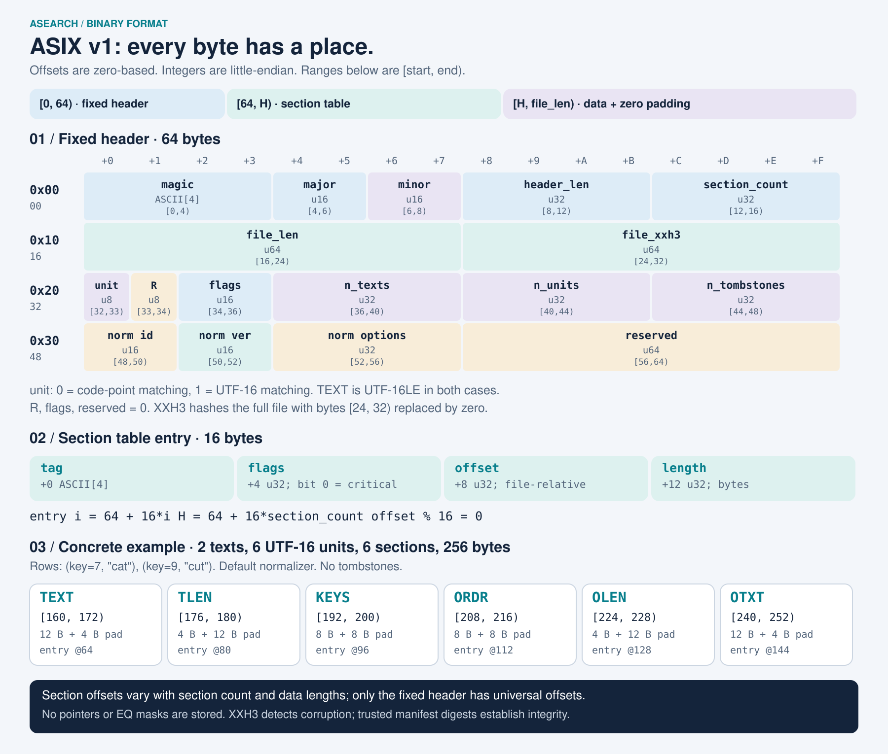

# ASIX v1: byte layout

[日本語](ja/asix-format.md) · [Documentation](README.md)

One `.asix` file contains one immutable search segment. It stores normalized text rows and metadata, with optional originals and tombstones. It contains no native pointers, serialized Rust structs, inverted lists or prebuilt EQ masks. The reader constructs runtime search structures after validation.



[Open the scalable SVG](assets/asix-layout.svg) · [Japanese-labeled image](assets/asix-layout.ja.svg). All offsets in this document are **zero-based byte offsets from the start of the file**. Ranges use `[start, end)`, excluding `end`. Every multibyte integer is unsigned and **little-endian**. Four-character tags are ASCII bytes in their written order.

## File organization

```text
[0, 64)       fixed header
[64, H)       section table: section_count entries × 16 bytes
[H, file_len) section payloads and zero padding

H = header_len = 64 + 16 * section_count
entry(i) = 64 + 16 * i            # 0 <= i < section_count
```

The header and each payload start on a 16-byte boundary. A payload's offset and length come from the table: they are not universal fixed constants. Payload ranges must not overlap; unused gaps and trailing padding must be zero. A zero-length section can share a boundary with another section. The writer rounds the end of each payload up to the next 16-byte boundary.

## Fixed header: 64 bytes

| Byte range | Hex start | Type    | Field                | Meaning                                                                                                                |
| ---------- | --------- | ------- | -------------------- | ---------------------------------------------------------------------------------------------------------------------- |
| `[0, 4)`   | `0x00`    | 4 bytes | `magic`              | ASCII `ASIX`: `41 53 49 58`.                                                                                           |
| `[4, 6)`   | `0x04`    | `u16`   | `major`              | `1`.                                                                                                                   |
| `[6, 8)`   | `0x06`    | `u16`   | `minor`              | Current writer emits `0`.                                                                                              |
| `[8, 12)`  | `0x08`    | `u32`   | `header_len`         | `64 + 16 * section_count`.                                                                                             |
| `[12, 16)` | `0x0C`    | `u32`   | `section_count`      | Number of section-table entries.                                                                                       |
| `[16, 24)` | `0x10`    | `u64`   | `file_len`           | Full file length, including padding. Must equal the actual byte length.                                                |
| `[24, 32)` | `0x18`    | `u64`   | `file_xxh3`          | XXH3-64 with seed 0; compute over the entire file while treating these eight bytes as zero. Also the segment identity. |
| `[32, 33)` | `0x20`    | `u8`    | `symbol_unit`        | `0`: code-point matching; `1`: UTF-16 code-unit matching.                                                              |
| `[33, 34)` | `0x21`    | `u8`    | reserved             | Zero.                                                                                                                  |
| `[34, 36)` | `0x22`    | `u16`   | reserved flags       | Zero; distinct from section flags.                                                                                     |
| `[36, 40)` | `0x24`    | `u32`   | `n_texts`            | Number of text rows, not necessarily the number of documents.                                                          |
| `[40, 44)` | `0x28`    | `u32`   | `n_units`            | Total UTF-16 code units in `TEXT`, regardless of `symbol_unit`.                                                        |
| `[44, 48)` | `0x2C`    | `u32`   | `n_tombstones`       | Number of document keys in `TOMB`.                                                                                     |
| `[48, 50)` | `0x30`    | `u16`   | `normalizer_id`      | `0`: none; `1`: `ja-basic`.                                                                                            |
| `[50, 52)` | `0x32`    | `u16`   | `normalizer_version` | Currently `1`, including for `none`.                                                                                   |
| `[52, 56)` | `0x34`    | `u32`   | `normalizer_options` | `none` requires `0`; `ja-basic` accepts six option bits, with default `31`.                                            |
| `[56, 64)` | `0x38`    | `u64`   | reserved             | Zero.                                                                                                                  |

`symbol_unit` changes the matching interpretation, **not the storage encoding**: `TEXT` and `OTXT` always contain UTF-16LE units. `AsearchTs` and `Ideal` both use unit `0`, so the field does not uniquely encode the semantic profile. Match the loader's expected unit and normalizer descriptor to the segment.

`ja-basic` option bits 0 through 5 control, respectively, ideographic-space conversion, fullwidth ASCII conversion, halfwidth-kana conversion/composition, katakana-to-hiragana folding, ASCII lowercase folding and dash folding. Bits 0–4 are enabled by default; bit 5 is disabled. This is a versioned, limited transform, not general NFKC normalization.

## Section-table entry: 16 bytes

For entry `i`, let `E = 64 + 16 * i`:

| Byte range         | Type          | Meaning                                                                           |
| ------------------ | ------------- | --------------------------------------------------------------------------------- |
| `[E, E + 4)`       | 4 ASCII bytes | Section `tag`, such as `TEXT`.                                                    |
| `[E + 4, E + 8)`   | `u32`         | Flags: bit 0 is `critical`; every other bit must be zero.                         |
| `[E + 8, E + 12)`  | `u32`         | Payload offset, relative to the file start, at or beyond `H` and divisible by 16. |
| `[E + 12, E + 16)` | `u32`         | Payload length in bytes, excluding padding.                                       |

Every tag must be unique. Readers use tags and offsets, not entry order. An unknown critical section is rejected; an unknown noncritical section is range-checked and skipped. Known tags must have exactly the flags and sizes below.

## Section payloads

Let `T = n_texts`, `U = n_units`, `D = n_tombstones`, and `O = sum(OLEN)`:

| Tag    | Flags | Presence              | Length  | Contents                                                                             |
| ------ | ----- | --------------------- | ------- | ------------------------------------------------------------------------------------ |
| `TEXT` | `1`   | Required              | `2 * U` | Concatenated normalized UTF-16 units, `u16[U]`.                                      |
| `TLEN` | `1`   | Required              | `2 * T` | Per-row normalized lengths, `u16[T]`; their sum must equal `U`.                      |
| `KEYS` | `1`   | Required              | `4 * T` | Stable document identities, `u32[T]`. A document with several texts repeats its key. |
| `ORDR` | `1`   | Optional              | `4 * T` | Per-row document ranking order, `u32[T]`. If absent, order equals key.               |
| `TOMB` | `1`   | Required when `D > 0` | `4 * D` | Strictly increasing, duplicate-free document keys, `u32[D]`.                         |
| `OLEN` | `0`   | Paired with `OTXT`    | `2 * T` | Per-row original UTF-16 lengths, `u16[T]`.                                           |
| `OTXT` | `0`   | Paired with `OLEN`    | `2 * O` | Concatenated original UTF-16 units.                                                  |

Optional and critical are independent concepts: `ORDR` may be absent, but a reader must understand it when present. `OLEN` and `OTXT` must both be present or both absent. The current builder preserves supplied originals and writes `TEXT`, `TLEN`, `KEYS`, `ORDR`, `OLEN`, `OTXT`, then `TOMB` when nonempty. Without originals, the native writer omits the original pair and places `TOMB` after `ORDR` if needed.

Rows are ordered by `(order, key, input text order within that key)`. Text rows of a document stay together with the same order. Individual normalized/original lengths fit in `u16`, up to 65,535 units; an empty text is valid. Normalizing an original must reproduce the corresponding normalized row. Missing originals are not reconstructed from normalized text.

When originals are absent, explanations use normalized coordinates unless the caller supplies an original that validates against the normalized row. The explanation's `coordinateSpace` identifies which coordinate system it uses.

A tombstone applies only to matching keys in **older segments**, not to rows in its own segment. Delta upserts therefore include both a tombstone and replacement text. A base and a delta use the same binary layout; there is no separate base/delta flag in the header. The manifest supplies the chronological segment order.

## Reproducible example: 256 bytes

Create `docs.jsonl` in the repository root, then run the CLI there. Use a new output path because the CLI does not overwrite existing output files.

```jsonl
{"key":7,"texts":["cat"]}
{"key":9,"texts":["cut"]}
```

```sh
cargo run --locked -p asearch-cli -- build docs.jsonl example.asix
```

Default normalization leaves these lowercase ASCII strings unchanged. The file contains 2 text rows, 6 normalized units, 6 sections, no tombstones and `H = 160`. Its header bytes are:

```text
0000  41 53 49 58 01 00 00 00 a0 00 00 00 06 00 00 00
0010  00 01 00 00 00 00 00 00 09 64 0d f1 e3 a7 a1 3b
0020  00 00 00 00 02 00 00 00 06 00 00 00 00 00 00 00
0030  01 00 01 00 1f 00 00 00 00 00 00 00 00 00 00 00
```

The checksum value is `0x3ba1a7e3f10d6409`; the stored bytes reverse its printed byte order because the field is little-endian.

| Entry offset | Tag    | Flags | Payload range | Decoded value                     | Following zero padding |
| ------------ | ------ | ----- | ------------- | --------------------------------- | ---------------------- |
| 64           | `TEXT` | 1     | `[160, 172)`  | `c a t c u t` as six UTF-16 units | `[172, 176)`           |
| 80           | `TLEN` | 1     | `[176, 180)`  | `[3, 3]`                          | `[180, 192)`           |
| 96           | `KEYS` | 1     | `[192, 200)`  | `[7, 9]`                          | `[200, 208)`           |
| 112          | `ORDR` | 1     | `[208, 216)`  | `[7, 9]`                          | `[216, 224)`           |
| 128          | `OLEN` | 0     | `[224, 228)`  | `[3, 3]`                          | `[228, 240)`           |
| 144          | `OTXT` | 0     | `[240, 252)`  | `c a t c u t` as six UTF-16 units | `[252, 256)`           |

The row lengths and alignment explain the 256-byte total. Different content, originals or tombstones change the table and payload offsets.

## Validation, compatibility and limits

The [reader](../crates/asearch-index/src/view.rs) checks header values, descriptors, checksum, table arithmetic, ranges, alignment, flags, unique tags, zero padding, row lengths/order and sorted tombstones before exposing borrowed data. The [engine loader](../crates/asearch-engine/src/index/format/load.rs) also checks original/normalized consistency and constructs bounded runtime structures. Passing structural parsing alone is not a substitute for full loading.

The v1 writer emits major 1/minor 0. The current reader checks major 1, but does not reject a file solely for a different minor number; compatible noncritical extensions remain subject to all other validation. New critical semantics require a new major version. Unknown optional sections are not retained during native reserialization.

Offsets are `u32`, and the current reader/writer also limit the entire file to `u32::MAX` bytes, even though `file_len` is `u64`. Configured limits are usually much smaller: defaults include 256 MiB input/data, 1,000,000 texts, 10,000,000 normalized units, 512 MiB working capacity and at most 8 segments. They are distinct budgets, not a guarantee that every file below the byte limit can load within the working limit.

XXH3 is a noncryptographic corruption check. Use a trusted manifest's cryptographic integrity value for downloaded content; an attacker can recompute XXH3. HTTP compression is outside ASIX: validate the decoded file bytes, not compressed transport bytes or a compressed `Content-Length`.

The [encoder](../crates/asearch-builder/src/encoding.rs) and [compatibility tests](../crates/asearch-engine/tests/builder.rs) anchor this description to the implementation and the pre-split v1 golden file. See [architecture](architecture.md) for publication and adoption responsibilities.
