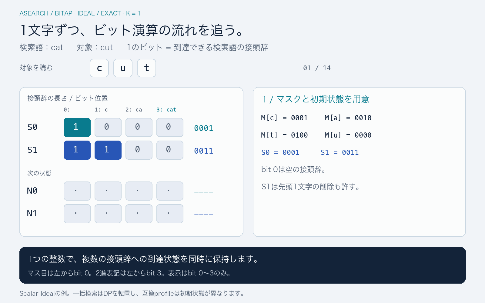

# Bitap：数値で追う処理の流れ

[English](../algorithm.md) · [日本語ガイド](README.md)

Bitapは、照合中に到達できる複数の位置をビットで表し、AND・OR・SHIFTでまとめて更新します。以下の動画では、オートマトンの1経路を辿る代わりに、実際の状態語と、次の状態を作る演算を示します。



[GIFを開く](../assets/bitap.ja.gif) · [最終フレームの静止画](../assets/bitap-poster.ja.png)。1600 × 1000の動画が約36秒でループします。以下の状態表と式だけでも一連の処理を追えます。

## この例で扱う範囲

[ScalarWmのIdeal漸化式](../../crates/asearch-engine/src/scalar/matching.rs)を使い、`MatchMode::Exact`、検索語`cat`、対象`cut`、編集上限`K = 1`で説明します。ASCIIだけを使い、正規化やワイルドカードのループは入れません。Exactは文字列全体を照合するモードで、`K`による曖昧照合は可能です。

すべてのエンジンが動画と同じ順序で動くわけではありません。互換matcherはビットの向きとprofileの初期状態が異なり、一括検索は後述の転置方式を使います。`IntentIndex`は、このスカラーのループではなく、上限付きのDAG × patternの費用計算を行います。

## 進み具合をビットへ置く

bit `i`は、検索語の先頭`i`記号を消費できたことを表します。`cat`ではbit 0が空の接頭辞、bit 1が`c`、bit 2が`ca`、bit 3が全文です。受理マスクは`1 << 3 = 1000`です。

`S[e]`は、対象の現在の接頭辞まで読んだときに、編集**e回以内**で到達できる位置の集合です。ビット列自体が編集回数の数値なのではありません。

| ビット位置       | 0   | 1   | 2    | 3     |
| ---------------- | --- | --- | ---- | ----- |
| 消費済みの検索語 | 空  | `c` | `ca` | `cat` |

動画のマス目は接頭辞の伸びを追えるよう、**左端をbit 0**にしています。通常の2進表記は**左端がbit 3**です。そのためマス目の`[0, 1, 0, 0]`は2進表記で`0010`です。表示するのはbit 0〜3だけで、それより上のビットが左シフトで受理位置へ戻ることはありません。

## マスクと初期状態を用意する

`M[x]`は、次のリテラルが`x`である検索語の位置を1にしたものです。文字を**消費する前**の位置を示します。

```text
M['c'] = 0001    M['a'] = 0010
M['t'] = 0100    M['u'] = 0000

S[0] = 0001     # 空の接頭辞、編集なし
S[1] = 0011     # 検索語の先頭1文字の削除も許す
```

長さ`m`の検索語では、Idealの`S[e]`の初期状態は、両端を含む位置`0..=min(e, m)`を1にします。対象をまだ読んでいなくても、検索語の先頭を最大`e`記号削除できるためです。したがって`e = 0`でもbit 0が立ち、検索語が空でなければ`e = 1`でbit 1も立ちます。

## 対象を1記号読む

新しく読む記号を`c`、前の状態を`S`、一時状態を`T`、次の状態を`N`とします。このExactの例では次の式になります。

```text
N[0] = (S[0] & M[c]) << 1

T[e] = ((S[e] & M[c]) << 1)   # リテラルの一致
     | (S[e - 1] << 1)        # 置換：対象と検索語を消費
     |  S[e - 1]              # 対象への挿入：対象だけを消費

N[e] = T[e] | (N[e - 1] << 1) # 検索語からの削除：対象を消費しない
```

まず前の状態から`T`を作り、次に少ない編集回数の行から順に、削除を伝播させます。実装は前の入力状態を上書きしないよう、最初の更新を大きいlevelから行い、削除の伝播を小さいlevelから行います。前後で別の配列を用意しても同じ式を表現できます。

ANDで一致を選び、SHIFTで検索語の位置を進め、ORで可能な経路をすべて残します。誤りの行は累積で、少ない編集で到達できる位置は、より大きい編集予算の行にも含まれます。

## 全ステップ：`cat`と`cut`

| 読み終えた対象 | 文字のマスク | 更新後の`S[0]` | 更新後の`S[1]` | 意味                                                             |
| -------------- | ------------ | -------------- | -------------- | ---------------------------------------------------------------- |
| 空             | —            | `0001`         | `0011`         | 初期状態。先頭1文字の削除も許す。                                |
| `c`            | `0001`       | `0010`         | `0111`         | `c`が一致して編集なしの経路が進み、編集1回の行にも可能性を残す。 |
| `cu`           | `0000`       | `0000`         | `0110`         | リテラル`u`はないが、置換によって位置2へ到達できる。             |
| `cut`          | `0100`       | `0000`         | `1000`         | `t`の一致で位置2から受理ビットへ進む。                           |

`u`ではリテラル一致の寄与は0です。**前の**`S[0] = 0010`を使い、置換の`S[0] << 1 = 0100`と、挿入の`S[0] = 0010`をORして`0110`を得ます。続く`t`では、一致の寄与が`(0110 & 0100) << 1 = 1000`になります。

対象全体を読み終えた後、受理ビットが立つ最小levelを答えとします。今回は`S[0] & 1000 = 0`、`S[1] & 1000 != 0`なので、**level 1**で一致します。`a`を`u`へ置換した結果です。同じ検索語`cat`は、`a`を削除した`ct`や、`r`を挿入した`cart`にもlevel 1で一致します。

## モードと互換性

- **Exact**：無料のループを持たず、編集予算内で対象全体を照合します。
- **Include**：開始位置と受理位置に無料のループを加え、対象の前後の文字を許します。
- **WildcardSpace**：検索語のASCII空白を、その位置で任意長を消費できる無料のループとして扱います。空白のリテラルや一般的な正規表現エンジンではありません。

ループを持つモードでは、記号を読むときに`S[e] & loop_mask`相当の項を加えます。境界の扱いは該当実装と合わせて確認してください。`AsearchTs`と`AsearchTsLib`は互換性のための挙動を維持しており、この例の累積的なIdealの初期状態と交換可能ではありません。また、ASIXの`symbol_unit`はcode pointとUTF-16の照合単位を区別するもので、profile間の意味論の差をすべて保存するものではありません。

1語に収まる検索語なら、各入力記号について、検索語の各位置へ別々の命令を実行する代わりに、`K + 1`個の状態levelに比例する更新を行います。複数語の状態では必要な語数と桁上がりの処理も増えます。ビット並列化は計算を減らしますが、検索語長、編集上限、コーパス量、ロードの費用がなくなるわけではありません。

## 一括検索との違い

[転置エンジン](../../crates/asearch-engine/src/transposed/matching.rs)は、**コーパスのtext位置**を`u64`へ詰め、検索語の行を順に進めます。記号の等価マスクでコーパス上の一致位置を選び、区切り・text・末尾のマスクで文書間の状態の漏れを防ぎます。ブロック単位の処理で作業領域も制限します。

一致・挿入・削除・置換の到達可能性をビット演算で統合する点は共通ですが、ビットの軸と外側のループが動画とは異なります。その後、索引層が各文書の最良textを選び、順位付けと複数セグメントの有効文書への絞り込みを行います。

セッションは、条件を満たす接頭辞のcheckpointを再利用したり、安全に絞り込める場合に完全な候補集合を再検証したりできます。これらは同じ検索意味論の実行戦略であり、前回の上位N件だけを検索する近似ではありません。

## 実装を読む

- [スカラーのコンパイル](../../crates/asearch-engine/src/scalar/compiler.rs)：文字マスク、受理ビット、無料のループ。
- [スカラーの照合](../../crates/asearch-engine/src/scalar/matching.rs)：初期化、記号ごとの更新、受理ビットの検査。
- [互換照合](../../crates/asearch-engine/src/matcher.rs)：profile固有の初期化と右シフト表現。
- [転置照合](../../crates/asearch-engine/src/transposed/matching.rs)：コーパスをビットへ置く行計算、ブロック、結果level。
- [スカラーの回帰テスト](../../crates/asearch-engine/tests/scalar.rs)：独立した動的計画法oracleとの比較。

## 参考資料

ビット並列の文字列検索は、Baeza-YatesとGonnetの[A New Approach to Text Searching（1992）](https://doi.org/10.1145/135239.135243)で紹介されています。Navarroの[A Guided Tour to Approximate String Matching](https://users.dcc.uchile.cl/~gnavarro/abstracts/acmcs01.1.html)は曖昧照合の手法を概観する資料です。この文書の式とトレースは本repoの実装を説明するもので、各論文のすべてのアルゴリズムが同じ表現を使うという意味ではありません。
