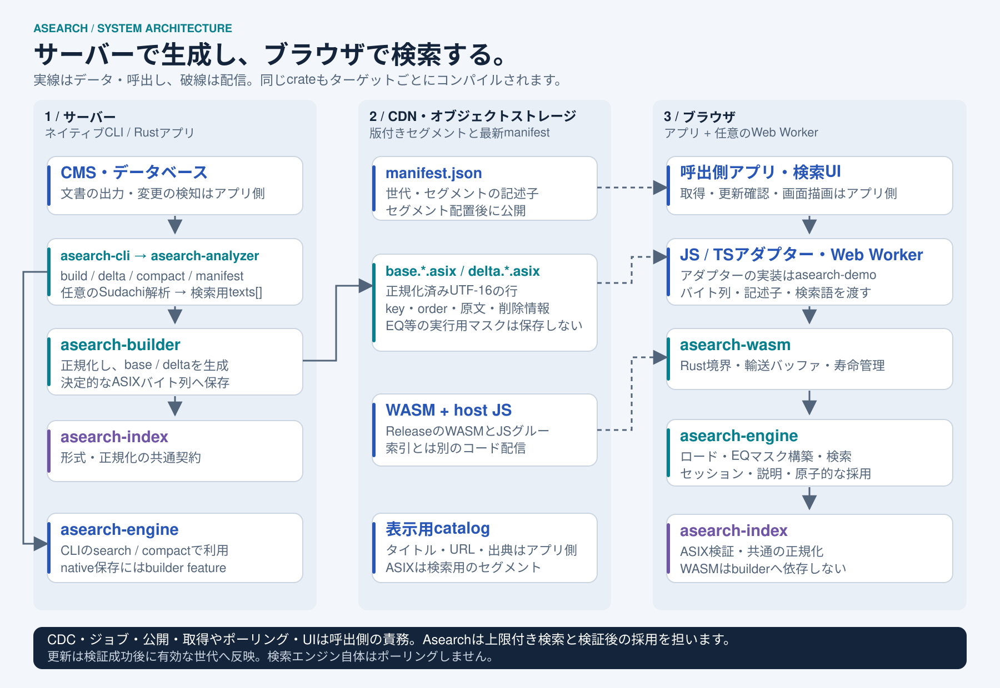

# アーキテクチャ：公開コンテンツからブラウザ検索まで

[English](../architecture.md) · [日本語ガイド](README.md)

Asearchは、**サーバーでのセグメント生成**と**クライアントでのロード・検索**を分けます。Webサービスがコンテンツを出力し、不変のASIXセグメントを生成・公開した後、ブラウザが検証済みの世代を採用します。CMS、通信、UIは呼出側の責務です。

[拡大できるSVGを開く](../assets/architecture.ja.svg)。矢印は主な呼出しと配信経路を表し、Cargoの全依存関係を列挙したものではありません。

## 5つのcrate

| crate             | Webサービスでの責務                                                                 | workspace内の直接依存                                    |
| ----------------- | ----------------------------------------------------------------------------------- | -------------------------------------------------------- |
| `asearch-index`   | 文書型、正規化器の記述子、資源上限、ASIX検証の共通契約。                            | なし                                                     |
| `asearch-builder` | サーバー入力を正規化し、検索エンジンを構築せずに決定的なbase/deltaを保存する。      | `asearch-index`                                          |
| `asearch-engine`  | セグメントのロード、派生検索構造の構築、検索、セッション、説明、原子的な更新。      | `asearch-index`、任意の`asearch-builder`                 |
| `asearch-cli`     | `build`、`delta`、`compact`、`manifest`、`search`を実行するネイティブのジョブ入口。 | `asearch-builder`、`asearch-engine`、`asearch-index`     |
| `asearch-wasm`    | `wasm-bindgen`を介したRustハンドルの公開、上限付きデータ輸送、寿命管理。            | 既定featureを無効にした`asearch-engine`、`asearch-index` |

`asearch-engine`はネイティブの構築・保存API向けに`builder` featureを既定で有効にします。WASM crateはこれを無効にするため、`asearch-builder`へ依存しません。同じ`asearch-index`のソースもターゲットごとにコンパイルされ、サーバーとブラウザが同一プロセスやメモリを共有するわけではありません。

## 初回の公開とロード

1. **呼出側が文書を出力する。** 文書は安定した`key`、表示順の`order`、1個以上の検索用textを持ちます。表示用URL、タイトル、出典は、同じkeyに紐付く別のcatalogで管理できます。
2. **サーバーがセグメントを生成する。** `asearch-cli build`がJSONLを`asearch-builder`向けに変換します。builderは正規化と行の整列を行い、[ASIXファイル](asix-format.md)を出力します。Rust製サーバーからbuilderを直接呼ぶこともできます。
3. **配信側がデータを先に、manifestを最後に公開する。** セグメントは版を含む不変URLで配置します。manifestは古い順のセグメント列、世代、バイト数、識別子、完全性確認用の値を記述します。この公開順序の制御は呼出側が行います。
4. **ブラウザがコードとデータを取得する。** 呼出側がWASMとJSグルーをロードし、manifest・catalog・セグメントを取得します。TSアダプターと検索UIの例は[demo repo](https://github.com/tkhshtsh0917/asearch-demo)で管理します。Asearch自体はカスタムHTML要素ではありません。
5. **WASMが検証後に実行用の構造を構築する。** ASIXが保存するのは正規化済みUTF-16行とメタデータで、EQマスクやポインタは含みません。`asearch-engine`は検証・復号後に、記号・EQ・ブロックの構造を資源上限内で構築します。このロードにはCPU・メモリの費用があり、ASIXはそのままメモリへ対応付ける形式ではありません。
6. **アプリが検索語を送り、コピーされた結果を描画する。** Web Workerを使えばロードや検索をメインスレッドから分離できます。セッションは上限付きの検索語状態を再利用します。結果の参照値は説明の取得に使えますが、セグメントの更新成功で失効します。

TSアダプターは入力の型と輸送上限を検査し、バイト列と期待する記述子をRustへ渡します。ASIXの形式・checksumの検査と、期待する記述子を指定した場合のSHA-384検証はRustが担います。図は、WASMを呼ぶ前にJS側で同じファイル完全性検証を重複実行することを求めるものではありません。

索引の生成、複数セグメントの圧縮、公開はサーバー側の処理です。ブラウザWASMはサーバー由来のセグメントをロード・検索・置換します。別機能の`IntentIndex`には上限付きの意図表現をコンパイルするAPIが残りますが、ASIXのwriterではありません。

## コンテンツの更新

CMSでの保存を、アプリのイベント、キュー、CDCなどで検知し、サーバーの生成ジョブを起動できます。ジョブはdeltaを生成し、CLIはすべてのupsert/remove対象keyを`TOMB`へ入れます。upsertには新しい文書のtextも含めます。TOMBは**古いセグメント**の同じkeyを無効にし、自分のセグメントにあるtextは無効にしません。

呼出側が新しいセグメントを配置し、新世代のmanifestを公開します。クライアントへの通知方法は、ポーリング、再読込み操作、通知などから選びます。Asearch自体はCDCやCDNへの購読を実装せず、全ユーザーへの同時更新も保証しません。

クライアントは受信データを一時保持・検証する間も、現在の世代を検索できます。更新成功時だけセグメント集合を切り替え、古い検索結果の参照を失効させます。失敗時は現在の世代を使い続けられます。旧データと候補を同時に保持するためのメモリが必要で、設定した予算に収まらない更新は拒否します。

サーバーは定期的に`asearch-cli compact`で有効な文書を新しいbaseへまとめ、古い列を置換するmanifestを公開できます。現行の上限は8セグメントで、圧縮のタイミングは呼出側が決めます。

## 索引へ入れる内容と信頼

配信するのは、ブラウザ利用者が閲覧してよい検索対象に限ります。ダウンロードした行や任意の原文は利用者から調べられるため、ASIXは暗号化やアクセス制御の境界にはなりません。非公開コンテンツの認可・検索はサーバー側で扱います。

埋め込みのXXH3は破損検知とセグメント識別に使います。信頼できるmanifestの暗号学的digestで取得バイト列の完全性を確認できます。ただし、ハッシュだけで公開権限を証明できるわけではありません。HTTPS、設定の信頼、公開用の認証情報は呼出側の責務です。

## コードのリリースとコンテンツの公開

両者は別の経路です。Rust repoのコードタグは、CI成功後にCLI・WASMのRelease Assetsを生成します。demoは選択したReleaseを検証し、グルーを生成して独自workflowで配信します。一方、コンテンツ更新ジョブはCLIで`.asix`とmanifestを公開するため、文書を編集するたびにRustのリリースを作る必要はありません。

[リリース連携](../../README.ja.md#release-assets)とdemoの[配信ガイド](https://github.com/tkhshtsh0917/asearch-demo/blob/main/docs/ja/deployment.md)を参照してください。この構成図は責務の説明であり、特定のホスト環境の設定完了を示すものではありません。

## 実装との対応

- [builder](../../crates/asearch-builder/src/lib.rs)：入力の正規化と決定的な保存。
- [ASIX reader](../../crates/asearch-index/src/view.rs)と[ランタイムのロード](../../crates/asearch-engine/src/index/format/load.rs)：形式検証後に実行用構造を構築。
- [セグメント集合](../../crates/asearch-engine/src/index/set/mod.rs)：有効な文書と更新の契約。
- [WASMの更新境界](../../crates/asearch-wasm/src/index/update.rs)：一時保持、予算の予約、採用。
