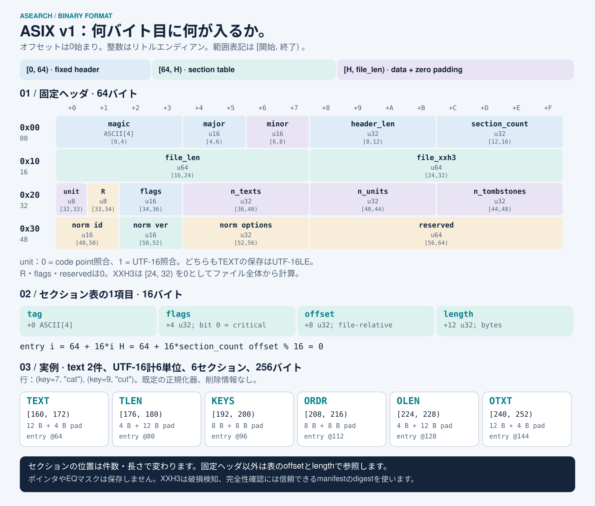

# ASIX v1：バイト配置

[English](../asix-format.md) · [日本語ガイド](README.md)

1つの`.asix`ファイルは、1つの不変な検索セグメントです。正規化済みのtext行とメタデータ、任意の原文と削除情報を保存します。ネイティブのポインタ、Rust構造体そのもの、転置リスト、構築済みEQマスクは含みません。readerが検証後に実行用の検索構造を構築します。



[拡大できるSVGを開く](../assets/asix-layout.ja.svg) · [英語版の画像](../assets/asix-layout.svg)。オフセットはすべて、**ファイル先頭を0とするバイト位置**です。範囲は終了位置を含まない`[開始, 終了)`で表します。複数バイトの整数はすべて符号なしの**リトルエンディアン**です。4文字のtagは、表記順のASCIIバイトです。

## ファイル全体

```text
[0, 64)       固定ヘッダ
[64, H)       セクション表：section_count項目 × 16バイト
[H, file_len) セクションのデータと0埋め

H = header_len = 64 + 16 * section_count
entry(i) = 64 + 16 * i            # 0 <= i < section_count
```

ヘッダと各データの先頭は16バイト境界に揃えます。データの位置と長さはセクション表から取得し、すべてのファイルで固定の位置ではありません。データ範囲の重複は許さず、使わない隙間と末尾は0で埋めます。長さ0のセクションは、別のセクションと境界を共有できます。writerは各データの末尾を次の16バイト境界まで切り上げます。

## 固定ヘッダ：64バイト

| バイト範囲 | 先頭の16進値 | 型      | フィールド           | 意味                                                                                      |
| ---------- | ------------ | ------- | -------------------- | ----------------------------------------------------------------------------------------- |
| `[0, 4)`   | `0x00`       | 4バイト | `magic`              | ASCIIの`ASIX`：`41 53 49 58`。                                                            |
| `[4, 6)`   | `0x04`       | `u16`   | `major`              | `1`。                                                                                     |
| `[6, 8)`   | `0x06`       | `u16`   | `minor`              | 現行writerは`0`を出力。                                                                   |
| `[8, 12)`  | `0x08`       | `u32`   | `header_len`         | `64 + 16 * section_count`。                                                               |
| `[12, 16)` | `0x0C`       | `u32`   | `section_count`      | セクション表の項目数。                                                                    |
| `[16, 24)` | `0x10`       | `u64`   | `file_len`           | 0埋めを含むファイル全長。実際のバイト数と一致すること。                                   |
| `[24, 32)` | `0x18`       | `u64`   | `file_xxh3`          | seed 0のXXH3-64。この8バイトを0とみなし、全ファイルから計算。セグメントの識別子も兼ねる。 |
| `[32, 33)` | `0x20`       | `u8`    | `symbol_unit`        | `0`：code point照合、`1`：UTF-16 code unit照合。                                          |
| `[33, 34)` | `0x21`       | `u8`    | 予約                 | 0。                                                                                       |
| `[34, 36)` | `0x22`       | `u16`   | 予約flags            | 0。セクションのflagsとは別の欄。                                                          |
| `[36, 40)` | `0x24`       | `u32`   | `n_texts`            | text行の数。文書数とは限らない。                                                          |
| `[40, 44)` | `0x28`       | `u32`   | `n_units`            | `symbol_unit`によらず、`TEXT`のUTF-16 code unit総数。                                     |
| `[44, 48)` | `0x2C`       | `u32`   | `n_tombstones`       | `TOMB`内の文書key数。                                                                     |
| `[48, 50)` | `0x30`       | `u16`   | `normalizer_id`      | `0`：none、`1`：`ja-basic`。                                                              |
| `[50, 52)` | `0x32`       | `u16`   | `normalizer_version` | 現在はnoneも含めて`1`。                                                                   |
| `[52, 56)` | `0x34`       | `u32`   | `normalizer_options` | noneでは`0`。`ja-basic`は6ビットの設定を受け付け、既定値は`31`。                          |
| `[56, 64)` | `0x38`       | `u64`   | 予約                 | 0。                                                                                       |

`symbol_unit`が変えるのは照合の解釈であり、**保存時の文字コードではありません**。`TEXT`と`OTXT`は常にUTF-16LEです。`AsearchTs`と`Ideal`はどちらも`0`を使うため、この欄だけで意味論のprofileを一意には決められません。loader側で期待する照合単位と正規化器の記述子を、ファイルに合わせてください。

`ja-basic`のbit 0〜5は、順に全角空白の変換、全角ASCIIの変換、半角カナの変換・合成、カタカナからひらがなへの変換、ASCII小文字化、ダッシュ類の変換を制御します。既定ではbit 0〜4が有効、bit 5が無効です。版を固定した限定的な変換であり、汎用のNFKC正規化ではありません。

## セクション表の1項目：16バイト

項目`i`の先頭を`E = 64 + 16 * i`とします。

| バイト範囲         | 型            | 意味                                              |
| ------------------ | ------------- | ------------------------------------------------- |
| `[E, E + 4)`       | ASCII 4バイト | `TEXT`などのセクション`tag`。                     |
| `[E + 4, E + 8)`   | `u32`         | bit 0が`critical`。ほかのビットはすべて0。        |
| `[E + 8, E + 12)`  | `u32`         | ファイル先頭からのデータ位置。`H`以上、16の倍数。 |
| `[E + 12, E + 16)` | `u32`         | データ長のバイト数。0埋めは含めない。             |

tagの重複は許しません。readerは項目の順序ではなくtagとoffsetで参照します。未知のcriticalセクションは拒否し、未知の非criticalセクションは範囲検査後に読み飛ばします。既知のtagは、以下のflagsと長さを厳密に満たす必要があります。

## 各セクションの内容

`T = n_texts`、`U = n_units`、`D = n_tombstones`、`O = sum(OLEN)`とします。

| tag    | flags | 有無            | 長さ    | 内容                                                          |
| ------ | ----- | --------------- | ------- | ------------------------------------------------------------- |
| `TEXT` | `1`   | 必須            | `2 * U` | 正規化済みUTF-16を連結した`u16[U]`。                          |
| `TLEN` | `1`   | 必須            | `2 * T` | 各行の正規化後の長さ`u16[T]`。合計が`U`に一致すること。       |
| `KEYS` | `1`   | 必須            | `4 * T` | 安定した文書IDの`u32[T]`。複数textの文書は同じkeyを繰り返す。 |
| `ORDR` | `1`   | 任意            | `4 * T` | 各行の文書表示順`u32[T]`。なければorder = key。               |
| `TOMB` | `1`   | `D > 0`なら必須 | `4 * D` | 昇順・重複なしの文書key、`u32[D]`。                           |
| `OLEN` | `0`   | `OTXT`と対      | `2 * T` | 各行の正規化前のUTF-16長`u16[T]`。                            |
| `OTXT` | `0`   | `OLEN`と対      | `2 * O` | 正規化前のUTF-16を連結した原文。                              |

任意であることとcriticalであることは別です。例えば`ORDR`は省略できますが、含まれる場合はreaderが理解する必要があります。`OLEN`と`OTXT`は両方存在するか、両方存在しないかのどちらかです。現行builderは入力の原文を保存し、`TEXT`、`TLEN`、`KEYS`、`ORDR`、`OLEN`、`OTXT`の順に出力し、空でない場合は`TOMB`を続けます。原文のない索引を保存するnative writerは原文の対を省略し、必要なら`ORDR`の次に`TOMB`を置きます。

行は`(order, key, 同じkey内の入力text順)`で整列します。同じ文書のtextは連続し、同じorderを持ちます。正規化後・原文それぞれの長さは`u16`に収まる最大65,535単位で、空のtextも有効です。原文を正規化した結果は対応する正規化済み行と一致する必要があります。欠落した原文を正規化済みtextから捏造しません。

原文がない場合、呼出側が正規化済み行との一致を検証できる原文を渡さなければ、説明は正規化後の座標を使います。どちらの座標系かは説明の`coordinateSpace`で区別します。

TOMBは**古いセグメント**の同じkeyだけを無効にし、自分のセグメントの行は無効にしません。そのためdeltaのupsertはTOMBと置換後のtextを両方持ちます。baseとdeltaは同じ形式で、ヘッダに両者を区別するflagsはありません。時系列のセグメント順はmanifestが与えます。

## 再現できる例：256バイト

repoルートに`docs.jsonl`を用意し、そこでCLIを実行します。出力済みファイルを上書きしないため、出力には新しいパスを使ってください。

```jsonl
{"key":7,"texts":["cat"]}
{"key":9,"texts":["cut"]}
```

```sh
cargo run --locked -p asearch-cli -- build docs.jsonl example.asix
```

既定の正規化はこのASCII小文字列を変えません。text 2行、正規化後6単位、6セクション、TOMBなし、`H = 160`です。固定ヘッダのバイト列は次のようになります。

```text
0000  41 53 49 58 01 00 00 00 a0 00 00 00 06 00 00 00
0010  00 01 00 00 00 00 00 00 09 64 0d f1 e3 a7 a1 3b
0020  00 00 00 00 02 00 00 00 06 00 00 00 00 00 00 00
0030  01 00 01 00 1f 00 00 00 00 00 00 00 00 00 00 00
```

checksumの値は`0x3ba1a7e3f10d6409`です。リトルエンディアンなので、バイト単位の保存順はこの16進表記の逆になります。

| 表項目の位置 | tag    | flags | データ範囲   | 復号した値                   | 直後の0埋め  |
| ------------ | ------ | ----- | ------------ | ---------------------------- | ------------ |
| 64           | `TEXT` | 1     | `[160, 172)` | UTF-16の6単位で`c a t c u t` | `[172, 176)` |
| 80           | `TLEN` | 1     | `[176, 180)` | `[3, 3]`                     | `[180, 192)` |
| 96           | `KEYS` | 1     | `[192, 200)` | `[7, 9]`                     | `[200, 208)` |
| 112          | `ORDR` | 1     | `[208, 216)` | `[7, 9]`                     | `[216, 224)` |
| 128          | `OLEN` | 0     | `[224, 228)` | `[3, 3]`                     | `[228, 240)` |
| 144          | `OTXT` | 0     | `[240, 252)` | UTF-16の6単位で`c a t c u t` | `[252, 256)` |

行の長さと境界調整から、合計256バイトになります。内容、原文の有無、TOMBが変われば、表とデータの位置も変わります。

## 検証・互換性・上限

[reader](../../crates/asearch-index/src/view.rs)は、ヘッダ値、記述子、checksum、表の計算、範囲、境界、flags、tagの一意性、0埋め、行の長さ・順序、TOMBの昇順を検査してから借用データを公開します。[engineのloader](../../crates/asearch-engine/src/index/format/load.rs)は原文と正規化後の一致も確認し、上限付きの実行用構造を構築します。構造のparse成功だけで、ロードのすべての検証を代用できるわけではありません。

v1 writerはmajor 1/minor 0を出力します。現行readerはmajor 1を検査しますが、minorが違うことだけでは拒否しません。互換な非critical拡張も、ほかの検証をすべて受けます。新たなcriticalな意味を持たせる変更はmajorを上げます。未知の任意セクションはnativeの再保存時には引き継ぎません。

offsetは`u32`で、現行reader・writerは`file_len`が`u64`でもファイル全体を`u32::MAX`バイト以下に制限します。設定上限は通常もっと小さく、既定では入力・データ256 MiB、text 100万件、正規化後1,000万単位、作業容量512 MiB、最大8セグメントです。これらは別々の予算であり、バイト上限内なら必ず作業容量内でロードできるという保証ではありません。

XXH3は暗号学的でない破損検知です。取得コンテンツには信頼できるmanifestの暗号学的な完全性確認用の値を使ってください。攻撃者もXXH3を再計算できます。HTTPの圧縮はASIXの外側なので、圧縮済み通信バイトや圧縮後の`Content-Length`ではなく、復号後のファイルを検証します。

[encoder](../../crates/asearch-builder/src/encoding.rs)と[互換性テスト](../../crates/asearch-engine/tests/builder.rs)が、実装およびcrate分割前のv1 goldenとの対応を確認しています。公開と採用の責務は[アーキテクチャ](architecture.md)を参照してください。
