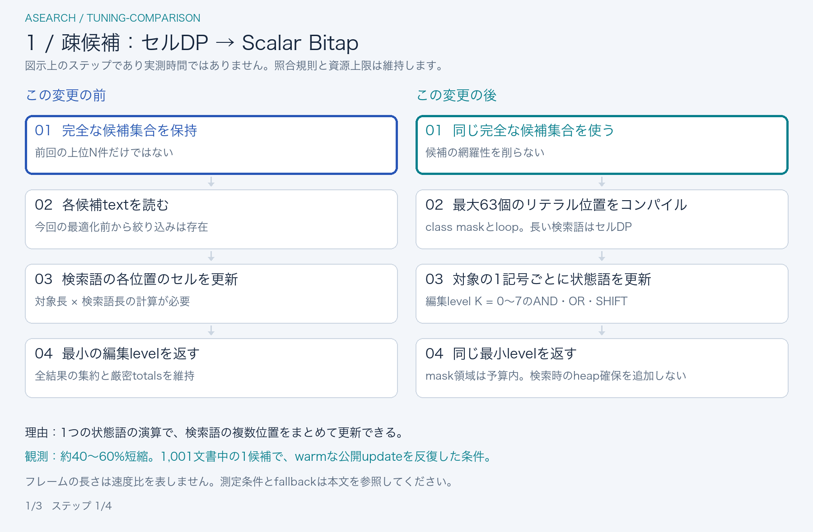
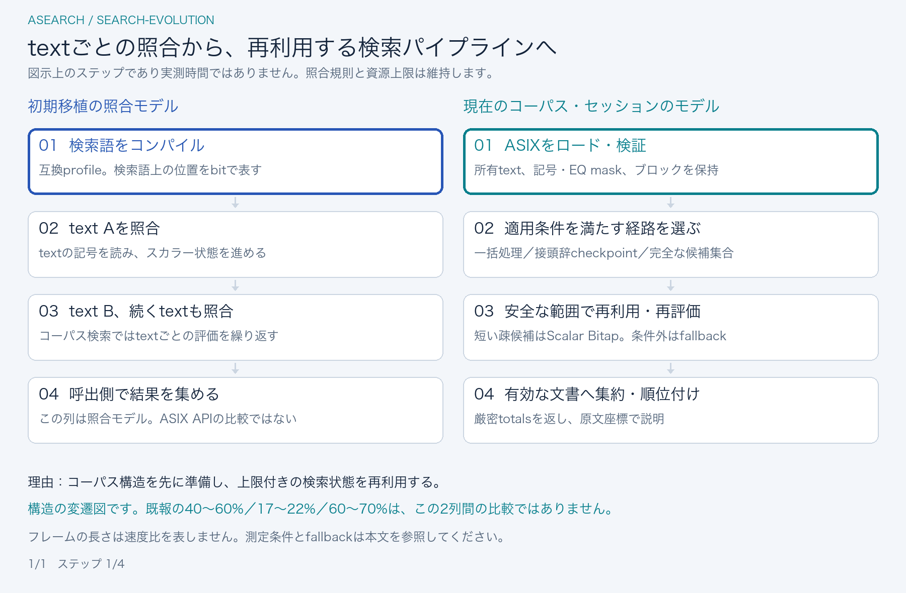

# 性能改善の採否

[English](../performance.md)

公開前のチューニングではASIX v1、厳密totals、順位、原文座標の説明、資源上限、更新の原子性を維持し、次の3件を採用しました。

| 変更                                       | 観測した効果                                      | 対象範囲                                                                                                                                      |
| ------------------------------------------ | ------------------------------------------------- | --------------------------------------------------------------------------------------------------------------------------------------------- |
| 完全な疎候補に対するScalar Bitap           | 対象経路のwarmな同一update反復で約40〜60%短縮     | 1,001文書・約200万単位の合成コーパスで候補が1件に絞られた短い検索語。ブラウザ標本は公開updateのバッチ平均で、個別打鍵の分位点ではありません。 |
| 所有済みの正規化textを再利用               | メモリ上のロード時間を約17〜22%短縮               | デモと同じ固定AutoWikiQA 1万質問。expectedのSHA-384検証を含み、HTTP取得・WASM初期化を除きます。                                               |
| 既存の文書範囲・maskで説明対象の生存を確認 | 後方ヒットの負荷で20件の説明結果群を約60〜70%短縮 | 1万文書の末尾にヒット文書を置いた合成コーパス。通常の日本語クエリでの差は小さいものでした。                                                   |

macOS arm64の1開発環境で、Node・Chromium・Firefox・WebKitをpaired AB/BAで比較し、別の測定組でも確認した観測です。**条件付きの改善**であり、Webサイト全体の速度倍率ではありません。通常の1万質問の打鍵負荷では検索時間の差ははるかに小さくなりました。ブラウザのバッチ平均、個別API呼出し、通信込みの起動、DOM反映は異なる指標です。rawの詳細や診断実験は製品契約には含めません。

## 何をどう変え、なぜ改善すると考えたか

以下で比べるのは、**今回のチューニング直前の実装**です。TypeScriptから移植しただけの初期版ではありません。比較元にも転置一括エンジン、接頭辞checkpoint、完全な候補集合による絞り込みが存在し、その内部の仕事を3点改善しました。

[比較GIFを開く](../assets/tuning-comparison.ja.gif) · [最後の場面の静止画](../assets/tuning-comparison.ja-poster.png)。1800 × 1180、3場面・26.4秒でループします。強調表示は処理の段階を示し、**実測時間や速度比を表しません**。以下の本文だけでも全変更を確認できます。

### 1. 完全な疎候補：セルごとの更新をScalar Bitapへ置換

**変更前 → 変更後。** セッションは以前から、前回の上位N件だけでなく、一致しうる完全な候補集合を保持していました。ただし各候補の評価では、対象textと検索語の各位置に対してセル単位の動的計画法を実行していました。現在の[候補評価](../../crates/asearch-engine/src/index/narrowing.rs)は、短い検索語を[上限付きのスカラーマスク](../../crates/asearch-engine/src/index/narrowing_bitap.rs)へコンパイルし、対象の1記号ごとにAND・OR・SHIFTで`u64`状態語を更新します。bitは検索語の位置を表し、一括エンジンのコーパス位置のbitとは別です。編集上限0〜7を最大8個の状態語で扱います。

**改善を見込んだ理由。** 候補が数件になると、検索語の各位置のセル更新がこの経路の主な費用になります。1語の演算で複数位置をまとめて更新できます。ただしclass maskのコンパイルや記号の探索は残るため、疎候補向けの改善であり、一括照合の全面置換ではありません。受理位置にも1bit必要なため、リテラルが63個を超える検索語はセルDPへfallbackします。候補が空ならコンパイルを省きます。

**維持する条件。** 候補集合の完全性、host casing候補、無料loopを維持します。mask容量は既存の予算へ計上し、検索時のheap確保は増やしません。独立したセルDPとの照合で全編集上限と語境界を確認し、公開sessionの回帰テストでids・最小level・order・厳密totalsを全量検索と照合します。

**実際の効果。** 1,001文書・約200万UTF-16単位の合成コーパスで、残った候補が1件の場合、warmな公開updateの反復時間を約**40〜60%短縮**しました。ブラウザ標本はupdate当たりのバッチ平均です。通常の1万質問の打鍵系列での差は小さく、この負荷の結果をWebサイト全体の改善率とはしません。

### 2. 派生構造：所有済みの正規化textを再利用

**変更前 → 変更後。** 所有側の索引はすでに正規化後のtextを保持していましたが、転置エンジンの構築には原文を渡していました。その計数・充填のpassで再び正規化し、正規化用の作業領域も必要でした。現在の[索引構築](../../crates/asearch-engine/src/index/build.rs)は、所有済みの正規化sliceを、内部専用の[`from_normalized`](../../crates/asearch-engine/src/transposed/mod.rs)へ渡します。EQ maskとブロックは、そのsliceから再正規化せず構築します。

**改善を見込んだ理由。** 必要なtextは、所有者と正規化記述子が明確な状態ですでに存在します。それを借用すれば、同じtextを再処理する費用と作業領域を省けます。新しい保存形式やブラウザ側のwriterも不要です。

**維持する条件。** 内部の構築経路を短縮するもので、未検証の公開入力を受け入れる経路ではありません。借用した原文を受ける公開構築APIでは、指定した正規化を維持します。ASIXの形式・完全性・原文と正規化後の関係は引き続き検証し、期待するSHA-384を指定した場合はその検査も行います。資源上限とASIX v1のbytesは変えず、等価性テストで両構築経路を比較します。

**実際の効果。** 固定AutoWikiQA 1万質問の、メモリ上の`fromBytes`を約**17〜22%短縮**しました。expectedのSHA-384検証を含み、HTTP取得・モジュールコンパイル・WASM初期化は除外します。検証に必要な正規化は残り、正規化全体ではなく、派生エンジン構築での重複を削っています。

### 3. 説明対象の生存確認：所属文書を探索してlive maskを読む

**変更前 → 変更後。** セグメント集合は結果textの説明を生成する前に、live文書の列を走査して所属・生存を確認していました。後方の文書ほど長い走査になり、結果を説明するたびに繰り返していました。現在の[`IndexSet::explain`](../../crates/asearch-engine/src/index/set/mod.rs)は、増加順の文書末尾へ`partition_point`を適用し、選んだ文書の開始境界と既存のlive maskを確認します。所属探索はセグメント内の文書数の対数に比例し、その後のmask確認は定数時間です。spanの計算は引き続きその後で行います。

**改善を見込んだ理由。** 文書表には、整列済みで重ならないtext範囲があり、セグメント集合はlive maskも保持しています。それを使えば、live列の全体走査も、別のlookup表の確保も不要です。後方ヒットの結果群では、削減した走査の費用が特に現れます。

**維持する条件。** 範囲外、空範囲、削除・置換済みのtextを引き続き拒否します。記述子の検査、更新世代、原文座標のspan、結果参照の寿命は変えません。空範囲の前後や無効aliasの所属確認を回帰テストし、版間で説明のtext・level・spanの一致も確認します。

**実際の効果。** 1万文書の後方ヒットを使う合成負荷で、公開説明20件の結果群を約**60〜70%短縮**しました。通常の日本語クエリでの差は約4%でした。説明前の所属確認の改善であり、検索全体やalignment全体がこの割合で速くなるわけではありません。

## 初期移植のモデルと現在の構造の違い

[変遷GIFを開く](../assets/search-evolution.ja.gif) · [全体の静止画](../assets/search-evolution.ja-poster.png)。1800 × 1180、8.8秒でループします。初期移植側は互換matcherの照合モデルです。検索語をコンパイルし、textごとに検索語位置のbit状態を進め、呼出側で結果を集めます。現在側はコーパス全体の処理系で、ASIXを検証・ロードし、EQ・ブロック構造を保持し、一括処理・接頭辞の再利用・安全な完全候補の評価を選び、有効文書へ集約して順位を付けます。

初期移植も**すでにBitapを使っています**。「Bitap以外をBitapへ置換した」という改善ではありません。スカラーと転置方式ではbitの軸が異なり、短い疎候補のkernelは追加の実行経路です。profileによって初期状態・casing・記号単位も異なるため、新旧すべてのAPIが同じ意味論という図でもありません。[数値で追うBitap解説](algorithm.md)と[サービス全体の構成](architecture.md)も参照してください。

今回の最適化前は`0b4e5f3`、採用した実装変更は`66b65ac`（候補Bitap）、`7f693c4`（正規化text再利用）、`ecf4b65`（所属探索）です。各改善率は、対応する変更前後の実験と別の確認測定から得たもので、すべてが共通の成果物ペアの比較ではなく、掛け合わせることもできません。初期移植から現在までの全体の速度比を測ったものではありません。動画のフレーム数と表示時間は説明用です。

## 既定ビルドを維持した理由

checkpoint削減は容量を減らせましたが、Backspace負荷を大きく遅くしました。ブロック幅やクリア・キャッシュの変更も、広く有効な改善を確立できなかったため既定値を維持します。

無料loopなしに限定したMyers試作はkernel単体では有望でしたが、製品が使う無料loopやhost casingを含む公開API全体で同値な効果を示していないためBitapと置き換えませんでした。自動生成SIMDと独立2ブロックを手動packingするSIMD行更新の試作も、WASMを二種類維持する効果を示さなかったため採用しません。すべてのSIMD設計が遅いという結論ではなく、製品は基本版WASMを維持します。

同じraw入力でBinaryenの`-O2`・`-O3`・`-O4`・`-Os`・`-Oz`を比較しました。raw出力が小さくてもBrotli出力や呼出時間が優れるとは限らず、glue生成後は`-O3`を維持します。Rustもrelease最適化・fat LTO・codegen unit 1を維持します。unsafe、新しいengine選択肢、バイナリ形式の拡張は追加していません。

## 比較の再現

Rust repoはraw CLI/WASMとRustの正しさ検証を担います。[integration性能ガイド](https://github.com/tkhshtsh0917/asearch-demo/blob/main/integration/docs/ja/performance.md)は変更前後の明示的なdist、seed固定系列、ロード・説明・ブラウザ比較を担います。[デモ計測ガイド](https://github.com/tkhshtsh0917/asearch-demo/blob/main/docs/ja/performance.md)はWorker往復と採用DOM mutationを説明します。

両revisionを同じ固定toolchain・依存版でビルドし、source commit/diff、raw Asset・生成物hash、コーパス・要求列hash、フラグを保持してください。fixtureは計時前に準備し、全結果を計時外で照合し、時計の0ms標本を残し、paired run全体を再標本化します。別processで確認し、中央値とtailの両方を見ます。無関係な過去のJSON同士をpaired測定として比較しません。

機能検証はASIX roundtrip、Unicode/casing/正規化、疎候補の語境界、古い参照の拒否、更新失敗、desktop/mobileのエミュレートされたブラウザプロファイルを含みます。有限のテストやfuzzで全入力の安全性を証明したとはせず、emulationでスマホ実機の性能を測ったとも扱いません。ネットワーク/CDNやサービス固有の負荷は配信環境でも評価してください。
