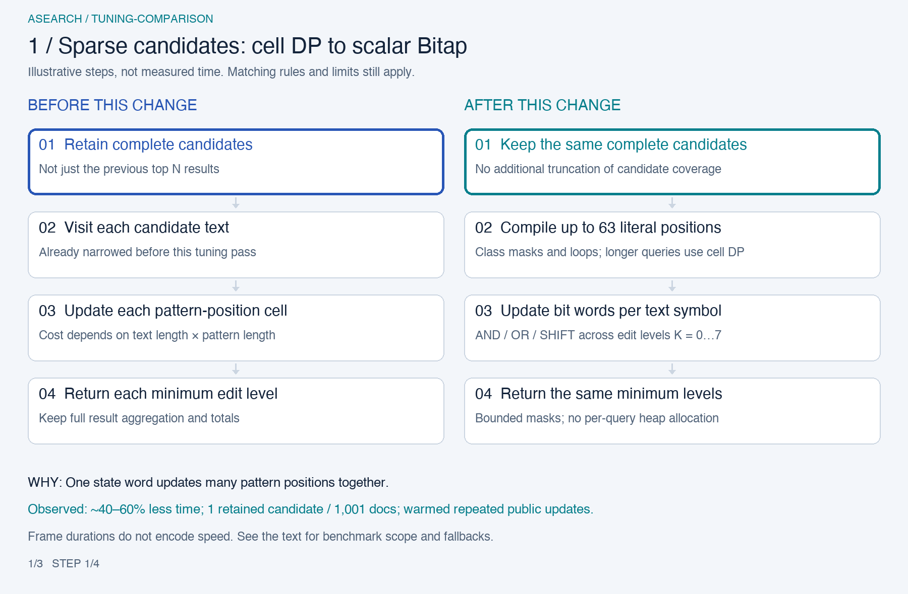
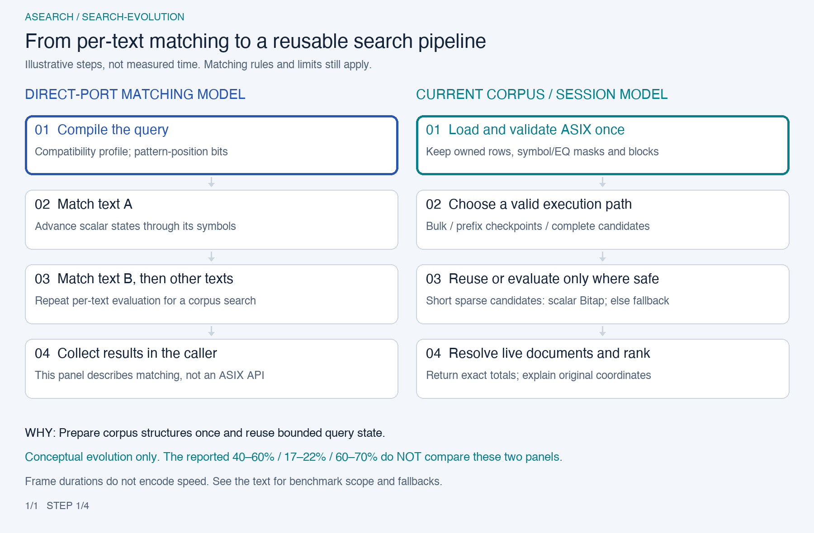

# Performance decisions

[日本語](ja/performance.md)

The first pre-release tuning pass kept ASIX v1, exact totals, ranking, original-coordinate explanations, resource limits and atomic update semantics unchanged. Three changes were retained:

| Change                                                             | Observed benefit                                                                    | Scope                                                                                                                                                                                              |
| ------------------------------------------------------------------ | ----------------------------------------------------------------------------------- | -------------------------------------------------------------------------------------------------------------------------------------------------------------------------------------------------- |
| Scalar Bitap for complete sparse candidates                        | Roughly 40–60% less time in the targeted warmed repeated-update comparisons         | A short query over a 1,001-document, roughly 2-million-unit synthetic corpus with one retained candidate. Browser samples are batch means of public updates, not individual keystroke percentiles. |
| Reuse already-normalized owned rows                                | Roughly 17–22% less in-memory load time                                             | The demo's fixed 10,000 AutoWikiQA questions, including expected SHA-384 verification; excludes HTTP and WASM initialization.                                                                      |
| Find explanation membership through existing document ranges/masks | Roughly 60–70% less time for a group of 20 explanations in the late-hit stress case | A 10,000-document synthetic corpus whose matching documents occur at the end. The ordinary Japanese query showed only a small difference.                                                          |

These are local Node/Chromium/Firefox/WebKit observations on one macOS arm64 development machine, using paired AB/BA runs and separate confirmation measurements. They are **conditional improvements**, not a general speedup factor for a website. The ordinary 10,000-question typing workload showed much smaller search differences. A browser batch average, an individual API call, a network-inclusive startup and a DOM update measure different things. Detailed raw runs and diagnostic experiments are not part of the product contract.

## What changed, and why

The following comparison is against the **pre-tuning implementation**, not a direct TypeScript-to-Rust port. That baseline already had a transposed bulk engine, prefix checkpoints and complete-candidate narrowing. The three optimizations improve work inside that existing architecture.

[Open the comparison GIF](assets/tuning-comparison.gif) · [Static final scene](assets/tuning-comparison-poster.png). The 1800 × 1180 animation has three scenes and loops in 26.4 seconds. Highlights show processing stages, **not elapsed time or a measured speed ratio**. The text below is the complete nonanimated alternative.

### 1. Complete sparse candidates: replace the cell loop with scalar Bitap

**Before → after.** The session already retained every potentially matching candidate, not just the previous top N. It evaluated each candidate with a cell-based dynamic-programming loop over text and pattern positions. Now [candidate evaluation](../crates/asearch-engine/src/index/narrowing.rs) compiles short queries into [bounded scalar masks](../crates/asearch-engine/src/index/narrowing_bitap.rs), then updates `u64` state words with AND, OR and SHIFT for each text symbol. Each bit represents a pattern position; this is distinct from the corpus-position bits of the bulk engine. Up to eight state words cover edit budgets 0 through 7.

**Why it should help.** Once only a few candidates remain, per-position cell updates dominate this path. One word operation can update many positions together. Class-mask compilation and symbol lookup still cost time, so this is a targeted sparse-query optimization, not a universal replacement for bulk matching. Queries with more than 63 literal positions keep the cell-DP fallback because an additional accepting bit is required. Empty candidate sets skip compilation.

**What stays true.** The complete candidate set, host casing classes and free loops are preserved. Mask capacity counts toward the existing budget; the query adds no heap allocation. Independent cell-DP comparisons cover all edit budgets and the word boundary, and public session regressions compare ids, minimum levels, order and exact totals against full search.

**Observed effect.** Warmed repeated public updates took roughly **40–60% less time** on the targeted 1,001-document synthetic corpus with about 2 million UTF-16 units and one retained candidate. Browser samples are batch means per update. Ordinary 10,000-question typing workloads showed much smaller differences; the stress result is not a website-wide gain.

### 2. Derived structures: reuse the owning index's normalized rows

**Before → after.** The owning index already retained normalized texts, but passed original rows to transposed-engine construction. Its count/fill passes applied normalization again and needed normalization scratch space. [Index construction](../crates/asearch-engine/src/index/build.rs) now borrows the owned normalized slices through the internal [`from_normalized` entry point](../crates/asearch-engine/src/transposed/mod.rs). The derived EQ masks and blocks are built from those slices without repeating normalization.

**Why it should help.** The necessary normalized rows already exist with an owner and a known descriptor. Reusing them avoids duplicate text processing and scratch work; no extra serialized index format or browser-side writer is needed.

**What stays true.** This is an internal construction shortcut, not an unchecked public input path. Public borrowed-original construction still applies the requested normalizer. ASIX decoding still validates format, integrity and the original/normalized relationship, including expected SHA-384 when supplied. The loader first checks format and integrity, reconstructs owned rows and derived structures, then compares the reconstructed normalized text with ASIX `TEXT` before returning the index. It does not hand downloaded rows directly to the internal shortcut as trusted input. Runtime budgets and ASIX v1 bytes remain unchanged; normalization equivalence tests compare both construction paths.

**Observed effect.** In-memory `fromBytes` took roughly **17–22% less time** on the fixed 10,000 AutoWikiQA questions, with expected SHA-384 verification included. HTTP, module compilation and WASM initialization are excluded. Normalization is still required for verification; the change removes duplicate derived-engine work rather than all normalization cost.

### 3. Explanation membership: locate a document before checking its live mask

**Before → after.** Before explaining a returned text, the segment set searched its live-document list for membership. Repeating that scan was expensive when the requested texts belonged to documents near the end. [`IndexSet::explain`](../crates/asearch-engine/src/index/set/mod.rs) now uses `partition_point` over increasing document end positions, checks the selected document's start boundary, then reads its existing live mask. Finding the owner is logarithmic in the segment's document count, followed by a constant-time mask check; span calculation still runs afterward.

**Why it should help.** The document table already contains sorted, disjoint text ranges and the segment set already has live masks. They can answer the question without scanning every live document or allocating a second lookup table. Late-hit groups make the avoided work especially visible.

**What stays true.** Out-of-range, empty-range and dead/replaced texts remain rejected. Descriptor checks, update generations, original-coordinate spans and result lifetimes are unchanged. Regressions cover membership around empty ranges and dead aliases, as well as identical explanation text, level and spans across versions.

**Observed effect.** A group of 20 public explanations took roughly **60–70% less time** in the 10,000-document synthetic late-hit workload. The ordinary Japanese query showed only about a 4% difference. This optimizes membership before explanation, not all search or alignment work by that percentage.

## Follow-up: compile code-value masks for longer sparse candidates

**Before → after.** Short-candidate Bitap originally searched the corpus alphabet for every input symbol, then searched the query masks by corpus ID. The [candidate planner](../crates/asearch-engine/src/index/narrowing.rs) now resolves those IDs once while compiling masks for longer candidate text. The scan searches masks directly by code value. The existing alphabet supplies the inverse mapping by array access; no additional dictionary or table is retained.

**Why it should help.** A relation fixed for the index need not be rediscovered at every text position. Translation has a preparation cost, so it is enabled only when the retained candidate-unit estimate is at least eight times the literal-class count. That estimate counts normalized UTF-16 units plus one separator per candidate, even for code-point profiles; it is a conservative cost heuristic, not a semantic condition or a universal crossover point. Shorter candidates keep corpus-ID masks. A const-generic helper specializes the two representations, keeping that choice outside the text scan. The complete-candidate safety rules and the cell-DP fallback above 63 literal positions stay unchanged.

**What stays true.** Corpus ID zero still means absent; code value zero is a real NUL and can have a mask. The host casing classes, UTF-16 profile, code-point profiles and lone surrogates are preserved. Independent DP comparisons cover remapped values and scalar boundaries. Owning-index, Node ESM/CJS and three-browser regressions compare results with full search. An allocation counter also exercises compilation and evaluation of this longer-candidate path. Retained structures, resource accounting and ASIX v1 bytes are unchanged.

**Observed effect and tradeoff.** Paired public-update batches over a 1,001-document synthetic corpus with one retained 1,150-unit candidate showed roughly **15–28% less time** across Node, Chromium, Firefox and WebKit. This is a warmed repeated query, not a typing or website-wide result. The ordinary 10,000-question Node traces did not establish a general improvement and showed roughly 1–5% median slowdowns across the final and confirmation groups; browser clock quantization limits conclusions about those individual calls. The generated `-O3` WASM grew from 295,090 to 297,659 bytes: +2,569 raw, +493 gzip-9 and +225 Brotli-11 bytes in this build. The earlier three-change GIF describes its original experiment; this follow-up only changes mask lookup within the scalar-candidate stage.

The final comparison for this follow-up used the following revisions. They identify the baseline, candidate and integration harness for the improvement and slowdown measurements above.

| Role                | Repository     | Commit                                     |
| ------------------- | -------------- | ------------------------------------------ |
| Baseline            | `asearch`      | `76c976ccb56cb757e3eea7caaf062e266f79e05e` |
| Candidate           | `asearch`      | `cf81eb3835a264571d1ba5f99259f62934c8041b` |
| Integration harness | `asearch-demo` | `e9d290ebc532d7cb5e5ef299dfa256b4334350d1` |

## Initial-port model versus the current architecture

[Open the evolution GIF](assets/search-evolution.gif) · [Static complete diagram](assets/search-evolution-poster.png). This 1800 × 1180 animation loops in 8.8 seconds. The initial-port panel describes the compatibility matcher's per-text approach: compile a query, advance pattern-position bit states through each text, then collect results in the caller. The current panel adds a corpus pipeline: validate/load ASIX, retain EQ/block structures, choose bulk processing, prefix reuse or safe complete-candidate evaluation, then aggregate live documents and rank results.

The initial port **already used Bitap**; the improvement is not “replacing a non-Bitap algorithm with Bitap.” Scalar and transposed implementations place bits on different axes, and the short-candidate kernel is an additional execution path. Profiles also differ in initialization, casing and symbol units, so this diagram is not a claim that all old and new APIs have identical semantics. See the [numerical Bitap walkthrough](algorithm.md) and [service architecture](architecture.md).

For the initial three changes, the pre-tuning baseline is `09784f6`. The retained implementation changes are `cfb1426` (candidate Bitap), `e47f265` (normalized-row reuse) and `50449c6` (membership lookup). Each reported effect comes from the corresponding before/after experiment, with separate confirmation; these percentages do not all describe one common artifact pair and must not be multiplied together. They do **not** measure the full journey from the initial port. Animation frame counts and durations are illustrative only.

## Reproducing comparisons

The Rust repository owns the raw CLI/WASM and Rust correctness tests. The [integration performance guide](https://github.com/tkhshtsh0917/asearch-demo/blob/main/integration/docs/performance.md) owns explicit before/after distributions, seeded traces, load/explanation measurements and browser comparisons. The [demo measurement guide](https://github.com/tkhshtsh0917/asearch-demo/blob/main/docs/performance.md) covers Worker round trips and accepted DOM mutations.

Build both revisions with the same locked toolchain and dependencies. Keep source commit/diff identity, raw asset and generated artifact hashes, corpus/workload hashes and flags. Prepare fixtures before timing, compare full outputs outside timing, preserve zero clock samples and resample whole paired runs. Confirm in another process and inspect both medians and tails. Do not compare unrelated historical JSON files as if they were paired measurements.

Functional coverage includes ASIX round trips, Unicode/casing/normalization, sparse-query word boundaries, old-reference rejection, update failures and emulated desktop/mobile browser profiles. Finite tests and fuzz runs do not prove all inputs safe, and emulation does not measure phone hardware performance. Network/CDN behavior and service-specific workloads still need deployment-level evaluation.
